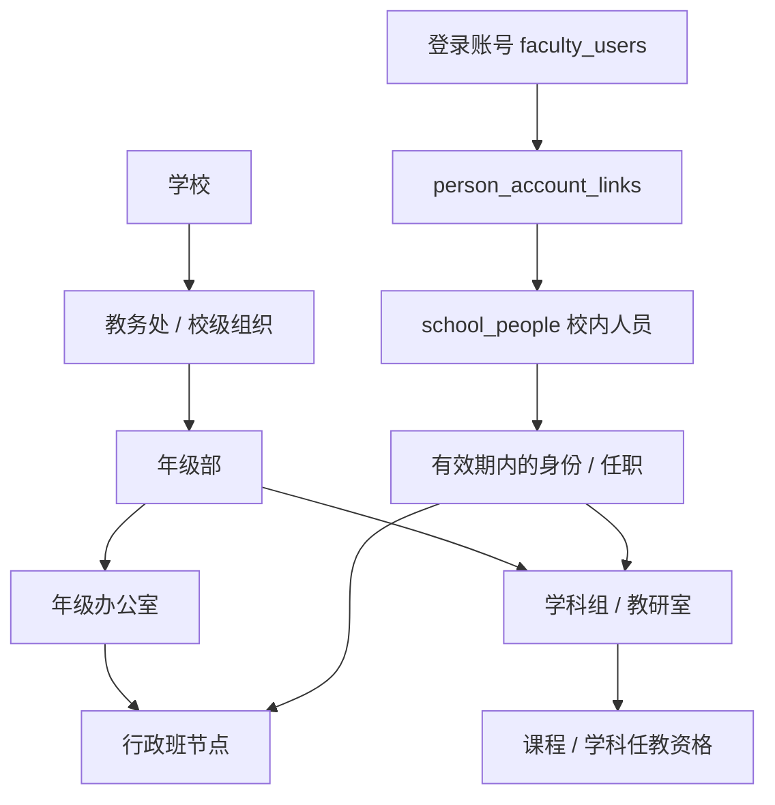
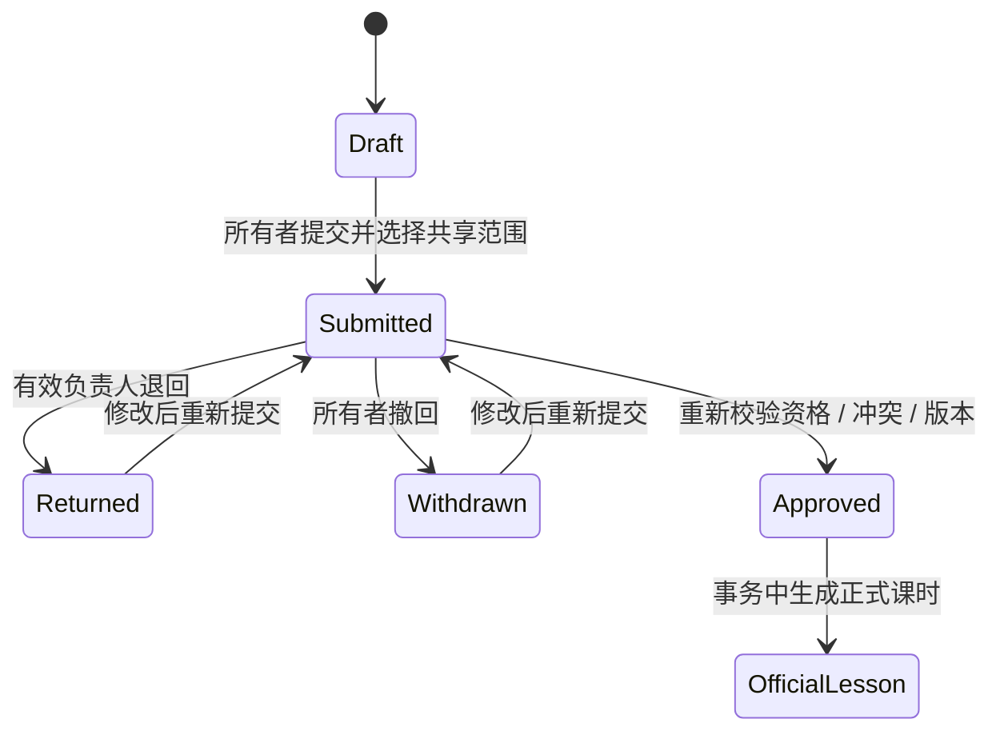

# 系统架构与工程取舍

## 部署与代码边界

| 层次 | 代码 | 职责 |
| --- | --- | --- |
| 界面 | `src/components/`、`src/services/sakuraApiService.ts` | 教学工作台、业务表单、调用历史脱敏、状态反馈 |
| 设计系统 | `src/styles/`、设计规范文档 | 1.0Sakura 主题、圆角、背景、加载与减少动效 |
| HTTP 应用 | `server/application.ts`、`server/auth.ts` | 挂载业务模块、认证 / CSRF、统一 JSON 错误与追踪号 |
| 业务授权 | `organizationCore.ts`、`scheduleSharing.ts`、各模块 | 有效任职、组织祖先链、任课、所有者、资源版本与审批规则 |
| 存储契约 | `server/asyncDatabase.ts`、`server/dbContract.ts` | 为原生 SQLite 和异步 TiDB 暴露共同调用方式 |
| TiDB 适配 | `server/tidb/` | 参数化 SQL 翻译、结果映射、事务、约束检查、HTTPS 驱动 |
| 边缘入口 | `cloudflare/worker.ts`、`tidb.ts`、`security.ts` | Secret 注入、HTTPS 边界、限速、Node / Express 适配与静态资源 |
| 本地入口 | `scripts/dev-portfolio.ts` | 空 SQLite + v15 迁移 + 同一业务应用，不依赖云端凭据 |

生产 Worker 为每次 API 调用建立请求范围内的应用及数据库客户端，避免把带认证状态的连接跨请求共享。请求经 `cloudflare:node` 桥接到 Express，最终走固定 HTTPS 目标访问 TiDB；原 Durable Object SQLite 只作为归档入口返回 403。

选择复用 Express 是为了保留业务 API 与 SQLite 测试的演进成果，代价是 Worker 中有 Node 兼容层与桥接开销。该项目没有把这个方案描述为所有边缘应用的默认最佳架构。

## 学校组织模型

这是实体之间的语义关系图，完整字段、外键和组织类型映射以 [v15 实现说明](verification/organization/README.md) 和 [TiDB schema](../server/tidb/schema.json) 为准。

“用户”“校内人员”“岗位”“实际任课”分别回答登录身份、人员去重、可管理范围和实际教学分工。不同学校的人员不按姓名猜测合并；一个人可以同时是班主任和学科组成员。可调度资格目录不推断私人日程，也不承诺该老师空闲。

权限使用后台记录与有效日期，不能由用户填写的部门字符串、前端角色或工号格式直接决定。账号 admin 允许配置资料，仍需单独任职才能获得对应组织的课表负责范围。人员别名不能绕过“不可审批本人申请”的约束。

## 数据域与共享

| 数据 | 主要授权依据 |
| --- | --- |
| 私有教案、未共享草稿 | 当前账号所有者；管理员身份不自动扩大读取 |
| 已发布班级教学资料 | 实际任课 / 当前班主任及对应模块的授权规则 |
| 课表提交 | 所有者、明确共享的教研室、有效任职及上级负责范围 |
| 可协调教师目录 | 同校、组织范围、学科 / 课程资格、当前有效任职 |
| 全局配置 | 应用管理员；配置权不等于所有私人正文的读取权 |

账号间的隔离为应用逻辑作用域，数据并没有按账号物理分库。`visibility=school` 的历史公开内容尚未具备完整机构边界；学生、家长、辅导员等也未成为完整的独立登录产品。相关未交付项明确列在 [路线图](ROADMAP.md)。

## 提交与审批的一致性

图表示业务流程，不是数据库状态常量的完整枚举。待审批提交不预占课时；审批事务在写入前重新验证当前任职、任课关系和教师 / 班级 / 教室重叠。版本号拒绝过期修改；自审按校内人员归并检查。归档、撤销任职和共享变化在后续请求重新计算，不依赖长时间权限缓存。

## SQLite 到 TiDB

生产采用 v15 业务结构平移：58 张迁移表、99 个外键、34 组旧触发器规则和 60 项检查。54 项检查由 TiDB 原生 CHECK 执行，其余 6 项及触发器语义由应用事务保护；不能说两种数据库的物理能力完全相同。

适配器对 SQLite 风格参数和部分表达式做有界转换，使用参数化查询，不提供面向浏览器的 SQL 执行 API。写事务锁定统一协调行并更新 epoch，以便互斥检查和并发冲突检测。这使小规模迁移较直接，但会限制吞吐；部分约束检查仍扫描表，大数据量下应改成精确行检查并独立压测。

TiDB 官方 HTTP 驱动及交互事务的预览 / 实验状态保留为明确依赖风险。相关说明和实际兼容测试见 [迁移记录](verification/tidb/README.md)。

## 故障、密码与日志

- 单次数据库 HTTPS 请求有 7 秒上限；写入及结果不明的 COMMIT 不自动重放。503 要求先确认保存结果，不把网络超时等同于业务失败。
- 前端区分 401 和临时数据故障；后者保留会话与输入，不能用自动退出掩盖数据库不可用。
- 密码采用限定成本的 scrypt、逐用户随机盐，再做独立 HMAC pepper。数据库与 CF Secret 分别保存摘要和密钥；正确登录在会话事务内升级旧成本。
- 日志不保存请求体、密码、SQL 参数或连接字符串；边缘入口拒绝凭据 URL 参数和数据库重定向。

完整凭据、轮换与恢复说明见 [安全更新](verification/security/CF-ENV-SECURITY.md)。

## 继续演进的优先级

先统一历史模块的机构授权并验证角色组合，再落地周模板 / 课程开设 / 授课班与 Key 报送；随后拆除写入全局协调瓶颈，补充容量与灾备演练。不能用增加数据库表的数量代替授权验收。
