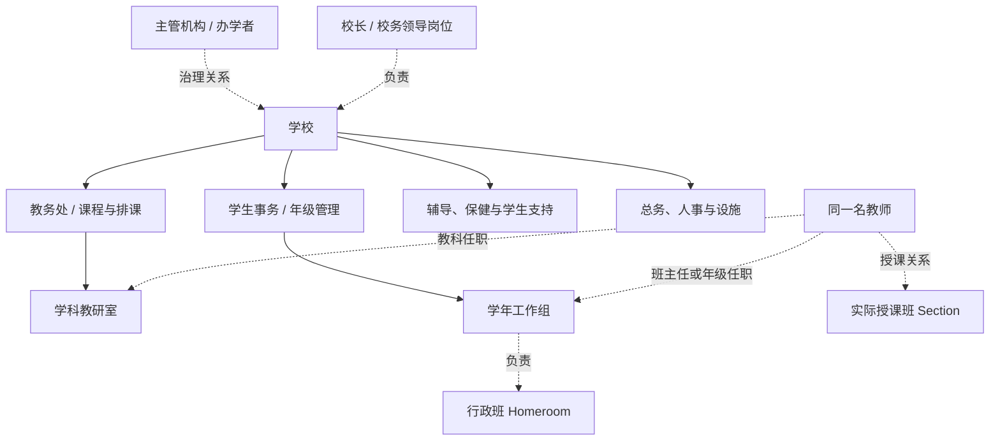
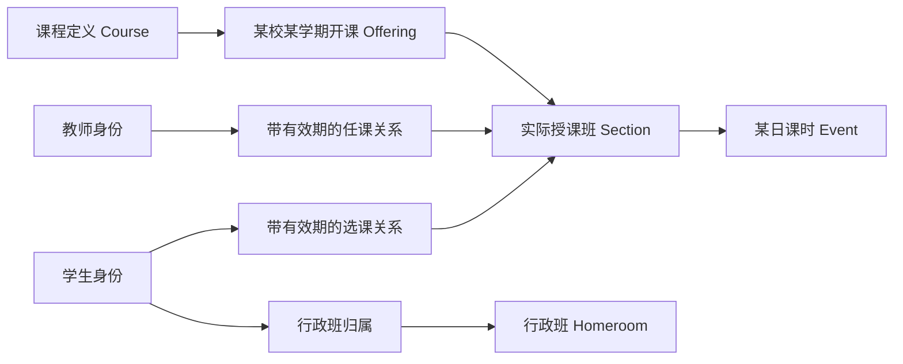

# SakuraEdu 学校组织与数据库架构提案

状态：目标模型；v15 已实现第一阶段。日期：2026-10-28。产品设计版本沿用 1.0Sakura。

本文件规定目标模型、现状差距和实施顺序。v15 已实现组织语义类型与上下级约束、校内人员关联、多岗位兼任、班级组织绑定、任教资格和范围内候选教师目录；详见 [v15 实施与验证](../verification/organization/README.md)。后文其余目标仍按阶段推进，不能据此认为完整隔离、Key 服务、账号表拆分或 Course Offering / Section 已经完成。

## 1. 建议采用的学校模型

采用“日本高中校务分工与年级管理 + 美国教育数据标准中的课程组织模型”。这是针对 SakuraEdu 的设计选择，各学校可配置组织模板、岗位名称和学年制度。

日本文部科学省资料将校务分掌描述为学校运行职责的分配，涉及教务、学生指导、年级、教科等协同关系；组织的名称和分工因学校实际情况而异。[MEXT 校务分掌资料](https://www.mext.go.jp/a_menu/shotou/seitoshidou/__icsFiles/afieldfile/2018/04/27/1404008_02.pdf)

美国 Ed-Fi 当前 v6 模型将课程定义、某学期开设的课程、具体授课班分开，并分别建立教师任课和学生选课关系。这有利于处理选修、走班、合班和共同授课。[Ed-Fi 教学模型](https://docs.ed-fi.org/reference/data-exchange/data-standard/model-reference/teaching-and-learning-domain/overview/)

日本也有不按学年划分课程的单位制高中。因此，数据库应允许按学年管理的行政班与灵活选课同时存在，不能把所有学习关系固定成“年级下的一个班”。[MEXT 单位制高中](https://www.mext.go.jp/a_menu/shotou/kaikaku/seido/04033102.htm)

CEDS 提供 Person、Organization、Course 等教育实体及其关系的参考；本提案借用实体边界，不承诺已经具备标准数据交换接口。[CEDS 数据模型](https://ceds.ed.gov/dataModel.aspx)

## 2. 现代科层制在数据库中的含义

学校应具备明确的职责、任职期限、授权范围、审批程序与可追溯记录。数据库分别保存以下事实：

| 事实 | 回答的问题 | 示例 |
| --- | --- | --- |
| 人员与身份 | 这个人是谁，以何种身份在校 | 王老师；本校教职工；也可能是本校学生的监护人 |
| 组织与岗位 | 哪个单位负责什么，设置哪些岗位 | 教务处负责全校排课；数学教研室设置主任岗位 |
| 任职与汇报 | 谁在什么时间担任岗位，向谁汇报 | 王老师本学年兼任年级主任与数学教师 |
| 业务关系 | 谁实际负责哪个对象 | 任教数学选修 A 班；担任行政班 2A 班主任 |
| 数据授权 | 对哪类数据可执行什么动作 | 可审批本室已提交课表，不可读取他人个人草稿 |

“职位高于某人”“负责一个组织”和“可以读取某人的所有数据”是不同的事实。岗位等级用于组织秩序；实际访问仍逐项检查动作、对象、范围、敏感级别、时间及当前业务关系。

学生、监护人通过在籍、选课、监护、辅导等关系连接学校，不进入职工直属汇报链。

## 3. 校内组织模板

下图是可配置的 SakuraEdu 初始模板。教研室与年级组可以平行存在；同一人通过多个任职参与不同分工。主管教育机构或办学者作为外部治理关系登记，不自动获得校内业务数据读取权。

这是一种职责矩阵：

- 行政关系决定人员管理与行政审批。
- 教科关系决定课程协调、教研和已共享材料的专业审核。
- 年级、行政班关系决定日常班务和约定的学生管理职责。
- 授课关系决定某个授课班、某段时间内的教学责任。
- 专业支持关系限定到实际分配的学生或个案；辅导员、心理咨询与保健人员不因岗位名称相似而互通全部记录。

每个任职可以有一个行政直属上级；专业指导、项目协调等另用有类型的关系记录。避免用一列 `manager_id` 表达一个人的全部关系，也避免用一条树表达所有教学关系。

## 4. 必须先修正的现状

以下结论保留讨论时 v14 源码的审计基线。v15 的已实现差异以文首实施链接为准，不把其余待办视作已实现能力。

| 当前结构或行为 | 现状限制 | 目标方向 |
| --- | --- | --- |
| `faculty_users` 同时保存账号、教师资料与 `admin/teacher` 标记 | 学生、监护人难以成为正常登录主体，多重身份难以表达 | 拆分账号、校内人员、身份与任职 |
| `identity_registry` 已有机构、身份种类与外部编号 | 缺少统一校内人员实体；不同身份是否属于同一人未独立表达 | 增加学校内的 `persons` 与经过确认的账号关联 |
| v12 组织树、岗位、任职、直属汇报关系 | 已有良好基础；固定父节点、岗位定义，不支持原地重组 | 保留旧定义，新增有效期版本与业务职责关系 |
| `academic_classes` 同时服务班务、任课、作业、考试 | 行政班与授课班混合，走班、跨年级选修困难 | 分离 Homeroom 与 Section |
| `teaching_assignments` 关联教师、班级、课程、学期 | 不能完整表达开课目录、教学组和授课班选课 | 增加 Offering、Section 与双方关联表 |
| `schedule_entries` 直接绑定单个教师、班级、课程及教室文本 | 共同授课、教室统一资源、重复课表版本难处理 | 课时关联 Section，教师和房间通过资源分配关联 |
| `schedule_submissions` 存一轮申请、当前状态及最后审批人 | 反复退回、重提后不能形成完整的独立审批版本链 | 申请修订、审批轮次、决定和正式记录分开 |
| `identity_objects.source_ref` 是文本引用 | 外键不能直接证明文本指向的业务对象真实存在 | 业务实体持有真实资源 FK，或使用有真实 FK 的类型化关联表 |
| `identity_object_bindings` 的哈希与确认字段 | 仅是元数据约束，未完成真实 Key 核销及身份核验服务 | 独立邀请、关系确认、授权与报送流水 |
| v14 课表已实现任职范围共享 | 当前审核仍按 `director` 等固定角色解释职责 | 后续改为明确的排课权限与职责范围 |
| 其他业务仍存在 `role='admin'` 或班级范围放行 | 完整用户隔离尚未完成 | 各模块统一调用业务授权层，覆盖列表与所有派生入口 |
| 云端固定 `getByName("school")` | 多个机构元数据仍共处一个业务存储实例 | 身份目录、学校正式记录与个人私有域分别路由 |

当前已有认证限速、SQL API 封禁及课表隔离测试。它们应保留，但不能替代上述结构升级。

## 5. 核心身份：账号、人员、身份、岗位、任职

### 5.1 账号不等于教师

`accounts` 负责用户名、凭证、会话与账号状态。用户名保持唯一、不可修改，显示姓名可为空；密码、Key 和校内档案不进入公开用户目录。

`persons` 表示某所学校内确认的一名自然人。该人可以同时拥有 staff、student、guardian 身份。人员主键使用不可预测的内部 ID；跨学校的同名、同邮箱或同手机号不会触发自动合并。

`account_subject_links` 保存账号与校内人员的已核验关联。同一账号可以关联多校身份；一名校内人员也可以没有登录账号。允许多账号关联同一人员时，自审限制按真实校内人员检查，不能通过第二个账号绕过。

监护关系独立于登录账号：一名监护人可以关联多个学生，一个学生也可以关联多名有不同权利范围的联系人。Ed-Fi 同样把 Contact 与学生的关联分开维护。[Ed-Fi 学生与联系人模型](https://docs.ed-fi.org/reference/data-exchange/data-standard/model-reference/student-identification-and-demographics-domain/overview/)

### 5.2 身份编号与 Key 分开

| 标识 | 用途 | 规则 |
| --- | --- | --- |
| `account_id / person_id / appointment_id` | 稳定内部关联 | 不用姓名、邮箱、工号作数据库主键 |
| `school + identity_kind + issuer + identifier_type + identifier_value` | 核对工号、学号或其他校内编号 | 带命名空间；工号 001 与学号 001 可并存；前导零保留 |
| 邀请 Key | 建立一次有目的的确认关系 | 高熵随机、短期、单次使用；存哈希，绑定用途与范围 |
| `request_id / idempotency_key` | 防止重复提交、核对异步结果 | 不授予身份或数据读取能力 |

账号用户名继续不可修改。机构允许更换工号、学号时，新增编号或别名记录并结束旧编号的有效期，内部人员 ID 保持不变，旧编号历史不改写；默认不把历史编号重新分配给其他人。

### 5.3 任职有时间与范围

岗位定义“需要承担的职责”，任职定义“某人何时担任该岗位”。雇佣关系、校内任职与实际任课分别记录，这与 Ed-Fi 区分就业关系、组织服务职责、教学任课的思路相符。[Ed-Fi 职工模型](https://docs.ed-fi.org/reference/data-exchange/data-standard/model-reference/staff-domain/overview/)

岗位模板可包含校长、副校长、教务负责人、教科主任、年级主任、教师、班主任、辅导员、学籍管理员、保健人员、总务人员。最终权限通过岗位的业务职责配置，不能靠岗位中文名或一个数字等级推导。

## 6. 教学组织：行政班与实际授课班分离

例如学生属于“2026 学年 2A 行政班”，同时选修“数学 II 周一班”和“英语口语跨年级班”。班主任负责行政班日常班务，数学老师负责其授课班；两者不是同一个授权范围。

课程是教学内容的稳定定义；Offering 是课程在某校某学期的实际开设；Section 是分组、容量与教学责任所在；Event 是一次具体发生的课时。

成绩、作业与课程出勤优先关联 Section；班会出勤与行政班事务关联 Homeroom；学生在籍关联学校。正式成绩、学分与学籍记录保存适用的课程、评定规则及发布版本。

学年、学期、年级名称、学分单位、评价量表和学校时区均可配置。美国与日本模板只改变默认术语和配置，不改变人员及教学关系的基础结构。

## 7. 数据分为个人域、学校正式记录、受限个案与报送快照

| 数据域 | 典型内容 | 默认访问依据 |
| --- | --- | --- |
| 个人私有域 | 个人草稿、未提交教案、个人工作笔记 | 本人；有具体范围的显式授权 |
| 学校正式记录 | 已批准课表、在籍、正式选课、已发布成绩 | 学校职责、任课/在籍关系、发布状态与字段规则 |
| 专业受限域 | 咨询、保健、保护性个案记录 | 专业岗位与实际个案分配，单独授权 |
| 报送快照 | 明确发给某接收者的字段和版本 | 已确认关系、报送用途与收件权限 |

这里需要区分四个主体：`subject_person_id` 是记录涉及谁，`created_by` 是谁录入，`steward_school_id` 是哪所学校管理正式记录，`private_owner_account_id` 是谁拥有个人草稿。学生是成绩记录的主体，录入老师是创建者，学校是正式记录的责任方；不能只用一个 `owner_id` 同时表达这些关系。

个人笔记和学生正式成绩应存为不同类型的业务对象，分别执行权限规则。学校身份或任职的建立，不会公开原有个人数据。

个人域表示应用的访问边界。包含学生信息的个人工作记录仍受学校配置的数据分类、保留、交接与导出规则约束，创建者不能由此获得无限期保留或任意再共享的权限。

平台 root 管理账号目录、账号状态和系统配置。校长、教务主任是另行确认的校内岗位。平台角色不附带业务正文读取、任意 SQL、全库业务导出或“以某用户身份登录”的能力。应用层隔离的威胁边界与底层运维访问分开定义；若未来要求连数据库运维也不能读取私人正文，须另外设计用户控制的加密与恢复机制。

## 8. 目标逻辑表目录

下表是领域目录。表名为目标名称，实施时优先复用现有主键和成熟表，按阶段建立兼容层，不要求一次新增全部表。

| 领域 | 主要表 | 关键关系或约束 |
| --- | --- | --- |
| 登录目录 | `accounts`, `account_credentials`, `auth_sessions` | 用户名唯一且固定；会话独立撤销 |
| 学校目录 | `school_registry`, `education_authority_links` | 公开路由元数据与学校正文分开 |
| 校内人员 | `persons`, `person_identifiers`, `person_affiliations`, `account_subject_links` | 人员有多个身份；编号带学校、种类和签发者 |
| 组织定义 | `organization_units`, `organization_unit_versions` | 稳定单位 ID，父子关系按有效期版本化；同一时点无循环 |
| 职责与任职 | `position_definitions`, `appointments`, `appointment_reporting_links` | 岗位不等于人；任职可兼任；汇报关系区分行政与专业 |
| 雇佣服务 | `staff_engagements` | 保存聘用或服务关系，与任课分开；薪酬详情不是普通教务数据 |
| 年度与班务 | `academic_years`, `academic_terms`, `grade_cohorts`, `homeroom_groups`, `homeroom_memberships`, `homeroom_staff_assignments`, `unit_cohort_responsibilities` | 学年、年级与行政班有历史；年级单位与教学分组分开 |
| 学校在籍 | `school_enrollments`, `enrollment_events` | 入学、转入、离校、复学保留时间线 |
| 课程与教学 | `course_definitions`, `course_versions`, `course_offerings`, `sections`, `section_staff_assignments`, `section_enrollments` | Course → Offering → Section；师生关系均有有效期 |
| 场地与日历 | `campuses`, `rooms`, `school_calendar_days`, `bell_schedules`, `bell_periods`, `timetable_patterns` | 教室用 ID；校历、轮换日与节次可配置 |
| 具体排课 | `teaching_events`, `event_instructors`, `event_room_allocations`, `event_revisions` | 课时支持多教师；资源冲突在事务内验证 |
| 作业与评价 | `assignments`, `assignment_targets`, `submissions`, `assessment_results`, `result_publications`, `credit_records` | 关联授课班与学生；草评、发布、订正分别记录 |
| 监护与支持 | `guardian_student_relationships`, `student_support_assignments` | 联系关系类型、有效期、可见范围及核验来源独立保存 |
| 受限个案 | `support_cases`, `case_memberships`, `case_notes` | 校内一般管理权限不能自动展开个案正文 |
| 统一业务授权 | `permission_definitions`, `role_permissions`, `responsibility_scopes`, `access_grants`, `resource_registry` | 动作、范围、对象与字段组合；默认无授权 |
| Key 确认与报送 | `relationship_invitations`, `relationship_confirmations`, `report_deliveries`, `report_snapshots` | 邀请、关系、实际授权、交付快照分别记账 |
| 流程与追踪 | `workflow_requests`, `request_revisions`, `review_rounds`, `review_decisions`, `audit_events`, `outbox_events`, `idempotency_records` | 原始提交与决定可追溯；跨存储交付可恢复 |

`responsibility_scopes` 和 `access_grants` 的目标应使用有外键的类型化关联。例如组织、授课班、学生、资源的独立关联表，或固定目标列加“恰好一个目标”的约束；不能退化成任意 `table_name + row_id` 字符串查询。

业务表通过真实 FK 关联 `resource_registry`；已存在的资源登记文本只能作为旧引用，不直接充当授权凭据。

## 9. 核心关系图

详细核心实体关系见 [school-core.mmd](school-core.mmd)。该图突出人员、任职、行政班与授课班，其他业务模块通过类型化资源关系接入。

账号目录、学校库和个人库分离后，图中跨存储的线表示服务端验证的逻辑关联；只有同一数据库内的关联可由 SQL 外键直接约束。

## 10. 权限如何计算

一次请求按以下顺序判定：登录会话 → 已核验的学校身份 → 有效任职或在籍 → 业务动作 → 对象与关系范围 → 敏感分类/发布状态 → 字段范围 → 明确拒绝及撤销状态。

| 主体 | 可配置的职责 | 默认不得由此推导的权限 |
| --- | --- | --- |
| 平台 root | 用户目录、冻结账号、系统运行配置 | 其他人的个人草稿和业务正文 |
| 校长 | 学校经营视图、指定事项的最终审批 | 所有咨询、保健及个人笔记全文 |
| 教务负责人 | 开课目录、资源排课、正式课表发布 | 教师未提交的私人备课内容 |
| 教科主任 | 本教科共享排课、课程协调与审核 | 其他教科的私人资料 |
| 年级主任 | 所负责年级的指定班务与统计 | 全校学生的全部个人记录 |
| 班主任 | 本行政班的明确班务、联络职责 | 每名学生的全部受限个案 |
| 任课教师 | 自己负责的 Section、作业、评价 | 同班其他教师的个人草稿 |
| 辅导或保健人员 | 分配给自己的支持对象或个案 | 其他人员的全部个案 |
| 监护人 | 已核验关系下、允许向其发布的学生记录 | 班级名单、其他学生信息、教师草评 |
| 学生 | 自己的课表、作业与已发布结果 | 其他学生和教师个人内容 |

权限检查要覆盖列表、详情、子记录、搜索、统计、通知、附件、导出及历史版本。可见的对象 ID 不代表可读取正文。岗位授权的生效、到期与撤销在每次请求中验证，缓存不能跨越其有效期或权限版本。

历史查询仍先检查查询者当前权限。请求中的 `as_of` 只能选择历史业务状态，不能恢复其已经撤销的任职。审批记录保存当时的任职、单位版本和授权策略版本，用于解释当时的决定。

现有 `director` 的祖先组织排课权限可作为兼容规则保留，逐步映射为 `schedule.review` 等具体权限。它不能直接推广为所有模块的“祖先节点可读全部”。

## 11. 共享与报送的两条通路

课表提交属于已声明的学校协作流程：有效任职范围 + 明确提交动作，决定该快照可向谁展示。原有 v14 课表行为保持兼容。

私人内容跨账号报送使用 Key 确认通路：邀请声明关系类型、用途、目标和有效期 → 已登录接收者核销 → 发起者确认接收账号 → 按需完成学校身份核验 → 建立具体授权或交付快照。

确认一个账号是监护人，不能仅靠双方输入同一个 Key 证明实际监护权；还需要学校认可的核验来源、处理人及关系范围。现有 v12 `confirmed` 元数据应保留其来源等级，不能自动当作完整身份认证结果。

上报锁定明确接收者、对象、字段和版本，平台不提供凭一个长期 Key 任意查询全库的入口。撤销关系阻止未来读取或投递；已经交付的快照按事先说明的保留与删除规则处理，接收者已下载的副本无法通过数据库状态撤销。

## 12. 工作流按申请修订和审批轮次保存

课表、成绩订正、个案转介等共用流程元数据，各自的业务负载仍有类型化表与真实 FK。

每次重提建立不可变修订，记录提交时的对象版本、范围、内容摘要与流程定义版本。审批决定追加保存，不覆盖上一轮退回原因。实际授权按审批时仍有效的身份及职责复查；提交时拥有权限不能保证未来继续拥有。

排课可配置为“任课教师提交 → 教科审核 → 涉及跨教科资源时教务复核 → 发布”。小规模学校可以只启用一级审核。跨教研室、跨校区时，不把原审批归属改写成新共享单位。

申请人与审批人的身份按校内人员判断，同时考虑代办链；禁止用第二个账号或代理身份完成自审。代办、临时负责人和应急授权要有范围、期限、来源与记录。

## 13. 历史和完整性约束

1. 学校业务表统一带 `school_id`。同库关联优先使用 `(school_id,id)` 复合唯一键与复合外键，阻止把 A 校对象挂到 B 校记录。所有参与复合 FK 的作用域列必须非空。[SQLite 外键文档](https://sqlite.org/foreignkeys.html)
2. 内部 ID 稳定；外部编号与显示名称分开。学校重命名、教师调岗、学生升年级不通过改写历史外键实现。
3. 任职、归属、任课、选课和关系采用有明确有效期的记录。以日为单位的业务日期和 UTC 时间戳分开；跨时区转换使用学校 IANA 时区，不能把所有学校固定为 UTC+8。
4. 目标有效期采用半开区间 `[from,to)`。当前 v12 `ends_on` 含结束当天，迁移时按当地日历转换并保留旧值来源，不能直接改变比较符。
5. 同一时点的组织归属无循环；行政直属关系按任职约束，专业关系按类型单独约束。历史重组建立有效期版本，不解除 v12 已生效迁移的不可变约束。
6. 主行政班可约束同一学校同一时点唯一；选课、联合教学、多个监护关系允许多对多。留级、转班、退选后重修通过新的关联记录表达。
7. 时间重叠、任职覆盖和资源冲突用事务内校验或触发器完成，不能仅靠前端或唯一索引。时间戳统一格式和排序规则。
8. 正式记录的批准、资源占用、版本更新和审计在同一事务提交。SQLite 连接保持外键检查；本地保留忙等待、失败响应及恢复验证。
9. 资源编号不同但对应同一物理教室时必须合并或建立别名。教室 ID 取代可随意输入的教室名称。共享场地和共同授课需要显式建模，避免正常合班被误判为冲突。
10. 单次课时使用实际日期。周课表是模板，经校历、轮换日和假期规则生成具体课时；已发生课时保持历史版本，不随模板变化自动改写。

## 14. SQLite / Cloudflare 的存储组织

推荐的目标存储边界：

| 存储 | 内容 | 原子协调边界 |
| --- | --- | --- |
| 身份目录库 / Directory DO | 账号、会话、学校路由和最小关联元数据 | 注册、认证、身份目录操作 |
| 每校 School DB / School DO | 学校组织、在籍、选课、正式课表、审批与正式业务记录 | 校内资源占用、审批、发布、审计 |
| 每用户 User Vault | 个人草稿、私人教案、个人笔记 | 本人的编辑、版本与提交发件箱 |
| 必要时单独的受限个案域 | 敏感个案与专业记录 | 个案成员与记录变更 |

首先保留一个学校内的正式排课在同一事务协调域，方便统一检查教师、Section 和教室的冲突；不按教师拆散同一学校的正式课表。

用户私有域和学校协作域之间传递明确提交的快照。它细化了旧隔离方案的“每人独立域”，同时容纳用户后来明确要求的学校排课协作。

Cloudflare 每个 SQLite-backed Durable Object 的事务围绕该对象的存储展开。本方案把跨目录、学校和个人域的操作设计为消息交付，不把它们视为一个 SQL 事务。[Cloudflare SQLite 存储 API](https://developers.cloudflare.com/durable-objects/api/sqlite-storage-api/)

提交交付流程：个人域保存不可变提交及 outbox → 学校域验证当前身份、用途和范围，以唯一请求 ID 接收一次 → 个人域确认回执。超时后按同一个请求 ID 查询或重试；请求 ID 相同但负载摘要不同返回冲突。界面区分“待确认”与“已提交”，避免把网络超时当作提交失败后再生成一份新申请。

跨校任教的可用时间不得自动读取另一所学校的课表正文。初期只保证校内冲突一致性；需要跨校强一致预约时另设有授权的预约协调服务，交换最小忙闲时段。未取得忙闲信息时标记未知，不显示为已确认空闲。

同库 FK 与跨库存储身份核对分别实现。多个库的备份和恢复需记录一致性水位、未交付事件和幂等状态；逐个恢复到不同时间点不能直接视为一个完整学校的统一恢复。

### 查询与交接规则

- 服务端从会话与已核验关联中解析当前学校，随后路由到该校存储；客户端的学校 ID、对象 ID 或 Key 都不直接决定数据域。
- 列表查询先带学校与业务范围条件，分页、统计、搜索和导出共享同一作用域；敏感字段通过固定投影返回。
- 常用索引围绕学校、所有者、Section、状态、时间范围和有效任职建立。权限元数据最多在单次请求内复用，避免对每一行反复全表扫描。
- 离职或调岗结束任职与会话中的相关授权，学校正式记录保留原录入人及审批来源；接任者按新职责读取明确范围，原私人草稿不会随岗位自动转交。
- 私人资料需要交接时，走明示的提交或报送流程。学生转班、退选、复学和学年晋升均新建或结束关系，保留已发生记录。

## 15. 从 v14 逐步迁移

下表是完整目标的建议顺序。v15 已完成 A 的兼容人员关联及组织任职基础，并在现有排课流程接入部分 C 的范围检查；其余内容继续使用后续迁移，不能将阶段 A—F 视为整体完成。

| 阶段 | 主要交付 | 兼容和验收条件 |
| --- | --- | --- |
| A：人员与学校边界 | `persons`、身份编号和账号关联；系统角色与学校岗位分离；明确学校作用域 | 旧账号 ID、登录与限速保持可用；不按姓名或邮箱猜合并 |
| B：教学基础 | 学年、Offering、Section、行政班、师生关联；统一房间 | 班务与授课互不替代；能表达选修、共同授课和历史转班 |
| C：统一业务授权 | 权限动作、职责范围、资源类型化关联；逐模块替换宽泛 admin/班级放行 | 列表、正文、搜索、导出、附件与统计使用同一规则；私人域默认拒绝 |
| D：流程和 Key 服务 | 申请修订、审批决定、关系邀请、核销、确认与报送快照 | 多账号自审、失效任职、Key 重放和错对象授权均被拒绝 |
| E：物理分域与路由 | 身份目录、学校库、用户 Vault；outbox、回执与幂等 | 只保留一个写入权威；断线、重试、恢复不会重复发布或丢失原文 |
| F：记录与报表扩展 | 发布成绩、学分、出勤、专业支持和报表 | 先建立分类权限再接入敏感正文；报表来源和版本可追溯 |

原有流程继续通过兼容适配器运行，相关模块逐个切换。需要物理重构的表在新迁移中复制、核对并切换；不修改 v1–v14 的历史 SQL 或校验值。切换回滚时仍保留新的拒绝规则，不能恢复曾经存在的广泛读取入口。

### 旧数据映射的具体规则

| 旧表 | 迁移处理 |
| --- | --- |
| `faculty_users` | 保留账号 ID，创建待核对的校内人员与 staff 关联；旧 admin 不自动成为校长 |
| `student_profiles` | 建立学生人员与在籍；其 `class_id` 只能形成有来源的行政班归属候选，不推断全部历史选课 |
| `academic_classes`, `class_enrollments` | 映射为行政班及成员历史；有明确教学语义的数据单独映射到 Section |
| `courses` | 保留课程代码和 ID，引入版本；不会按名称合并同名课程 |
| `teaching_assignments` | 按学校、学期、课程和原教学分组生成 Offering/Section 候选并核对，保留旧 ID 对照；同班同课不同教师不能无条件认定为共同授课 |
| `schedule_entries` | 按明确的日期、任课及学期证据关联 Section，教室文本经核对映射为房间 ID |
| `schedule_submissions`, `schedule_changes` | 保留原始记录、源版本和审批归属；现有可证实的状态转为兼容流程记录，不编造缺失的历史审批决定 |
| `identity_registry`, `identity_appointments` | 保留内部 ID 和证据来源；无人员核验的关联不自动升格为已认证关系 |
| `identity_object_bindings` | 把对象文字引用与真实业务对象核对；旧哈希不能自动变成有效邀请 Key 或读取权限 |

无法确定学校、学期、Section、监护关系或历史起止日期的记录进入映射待办。保留旧记录并显示“待核对”，不为了填满新表而猜测归属或静默公开数据。

## 16. 架构验收场景

| 场景 | 必须得到的结果 |
| --- | --- |
| 同一老师兼任数学教师、2A 班主任和年级主任 | 三项任职分别生效；各自数据范围独立 |
| 两校使用同一学号，同一人又有职工和监护人身份 | 正确区分编号命名空间，关联不串校 |
| 学生转行政班但保持数学选修班 | 班务归属改变，原选课与已发生课时保持正确 |
| 教师换教研室，旧任职结束 | 新请求按新职责判断；旧审批归属和人员履历保留 |
| 主任使用另一个已关联账号审批自己的申请 | 按校内人员关联拒绝自审 |
| root 搜索私人教案或下载个人域全库 | 被业务服务拒绝；目录身份不提供正文读取 |
| 普通教师拥有学生所在行政班的关联 | 仍不能据此展开他人私人笔记或全部个案 |
| 同一教室被不同文本别名引用；两人同时批准重叠课时 | 统一房间身份，事务中只允许满足规则的发布 |
| 临时负责人、代课老师任职到期 | 新审批或业务访问失效，历史记录仍可追溯 |
| 邀请过期、错对象、第二次核销或绑定伪造监护关系 | 拒绝，不生成可用授权 |
| 私人域提交后超时、重复投递或服务重启 | 同请求只生成一个学校申请，状态可核对 |
| 午夜、夏令时、跨学期、校历休课和年级晋升 | 使用学校时区与有效期，历史课时不被重写 |
| 私有、共享、受限个案通过搜索/统计/附件/导出访问 | 与正文路径执行一致权限，避免旁路泄露 |

## 17. 近期优先决策

建议先固定四项基础，再进入新迁移：

1. 一所学校作为机构业务域；root 作为平台目录职责，校长作为校内岗位。
2. 个人私有内容与学校正式记录分域，已有明确提交的课表协作保留。
3. 身份以校内人员为中心，兼任通过多条任职表达；学生与监护人使用业务关系连接。
4. 行政班与授课班分离，正式课表围绕 Section 与真实房间组织。

这些基础能够同时支撑现有教研室排课、后续学生/家长登录与更完整的权限隔离，也能让日本式学年管理与美国式选课在同一个模型中运行。
