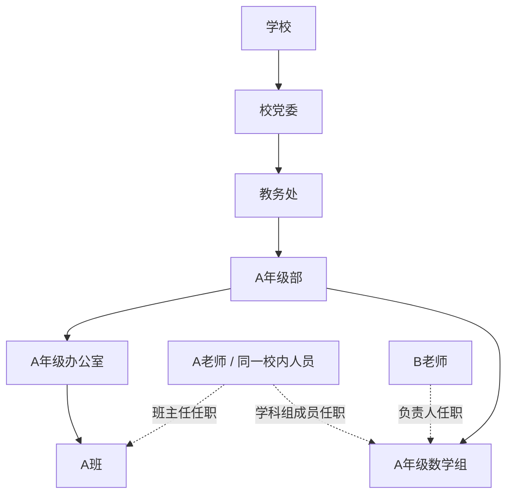

# v15：组织链、兼任与任教资格

2026-10-28，1.0Sakura。此版本实现 [学校架构目标](../../architecture/ADR-0001-school-organization.md) 的第一阶段，保留已有账号、课程、班级和课表主键。

## 配置顺序

管理员进入“课表与排课 → 组织架构与兼任配置”。

1. 在基础资料准备课程、学期、班级及实际任课关系。在组织配置中新建学校、学科，并将课程明确关联到本校学科。
2. 建立组织链：学校 → 校党委 → 教务处 → 年级部 → 年级办公室 → 行政班。年级部或教务处下可另设学科组 / 教研室，学科组必须指定本校学科。通用处室、部门兼容旧结构，不强制所有学校照搬此模板。
3. 按不可变用户名核对账号，设置任职单位、岗位、开始与结束日期；同一人员可同时担任班主任、学科组成员或负责人。直属上级可选，仍需满足同校、有效任职、组织及岗位层级约束，不能跨学校或向同一人员的另一个账号汇报。
4. 将真实教务班级绑定到行政班节点。绑定后，该班班主任权限取自当前有效班主任任职，旧 `head_teacher_id` 不再作为权限来源；任职到期不会回退旧字段。未绑定班级保留历史行为，以便逐步迁移。
5. 为学科组任职确认可任教课程及资格期限。有效的实际任课关系也可作为本校、本学科课程的资格证据；仅有部门名称或教师头衔不够。

日期按北京时间的日历日判断，结束日包含当天。当前不提供拖动重挂、解除班级绑定或静默替换历史组织的功能；组织调整应新建定义并保留原有记录。

## A / B 场景

B 在“可协调教师 · 组织与学科目录”选择负责范围及课程，可看到符合资格的 A，按同一校内人员去重，并展示 A 在同一学校的有效兼任和完整组织路径。B 不因此获得 A 班学生记录、A 的私人草稿、其他学校任职或私人联系方式。有效上级负责人可查所负责下属范围；平行学科组和其他学校拒绝访问。

目录是资格候选，不推断私人日程或承诺空闲。选择候选可填入现有调代课申请，提交与审批均重新检查资格、有效任职和课时冲突；正式变更仍走审批。负责人不能通过同一校内人员的另一个账号审批自己的申请。

## 增量结构

新增 10 张表：`school_people`、`person_account_links`、`identity_person_links`、`organization_unit_types`、`organization_parent_rules`、`school_subjects`、`subject_courses`、`organization_unit_profiles`、`organization_class_links`、`staff_course_qualifications`。复用 v12 的组织、身份、岗位、任职、直属汇报；新增 `homeroom_teacher`、`subject_member` 角色。

语义类型由 profile 保存，兼容旧 `organization_units.kind` 约束：校党委、教务处和年级部映射到 `division`，年级办公室映射到 `grade`，行政班映射到 `class`，学科组映射到 `department`。数据库同时校验语义上下级和原始结构，不按显示名称判断授权。

已有身份只按明确的“学校 + 账号”关联校内人员；未绑定账号的身份各自建立人员，不按姓名或邮箱猜测合并。跨校不合并。旧账号管理员身份不会自动变成校务负责人。资格、身份和人员关联由外键及触发器保护；同一班级不能存在日期重叠的有效班主任任职。

旧 v1—v14 迁移与校验值保持不变。Native SQLite 在 v15 升级前生成 `data/migration-backups/before-v15-*.sqlite`，本次另保存了源码 Git bundle 与在线数据库备份，路径记录在忽略目录 `.local-data/latest-reliability-backup.json`。Cloudflare 继续使用原 v11 基线并顺序应用 v12—v15，不重建 Durable Object，也不开放 SQL 下载或任意查询接口。云端未导入测试学校或测试账号。

## 验证证据

- `npm run test:organization`：22 组真实 HTTP / Native SQLite 测试，[native.json](native.json)。覆盖真实 v14 升级、原身份保留、组织链、A 的兼任、B 的资格目录、跨组跨校拒绝、班主任权限切换和到期、任课证据、同人员多账号自审、调代课资格与审批、撤销、父组织归档、外键、重复迁移和完整性检查。
- `npm run test:organization-workers`：4 组 Workers / Durable Object SQLite 测试，[workers.json](workers.json)。在已有 v14 状态上升级，验证组织链、班主任与负责人权限差异、候选去重、资格撤销及父组织归档。脚本仅允许本机测试地址。
- 回归：注册登录 6 组、冷却保护 9 组、v12 组织关系 16 组、课表共享 17 组、SQLite 可靠性 11 组，以及 Workers 课表共享 4 组通过。TypeScript、Workers 类型检查和生产构建通过。
- 浏览器使用隔离测试库和产品组件，验证 B 看到 A 的两项任职，管理员切换节点类型后上级候选随之受限：[教师目录](dispatch-directory.png)、[组织配置](organization-tree.png)。便捷会话夹具仅保存在忽略目录，未进入产品或生产部署。
- 部署后检查见 [线上验证](../security/remote.json)，部署版本见 [deployment.json](deployment.json)。线上检查只读取组织元数据，不创建业务测试数据。

## 尚未完成

登录仍使用 `faculty_users`，人员表目前是兼容关联层；尚未实现完整账户 / 人员拆表、首次注册 root、Key 邀请与报送、独立用户 Vault、Course Offering / Section，以及全模块统一授权。历史教案、作业等模块原有管理员或班级范围授权仍需逐项收紧，本版本不宣称已完成全产品多租户隔离。
